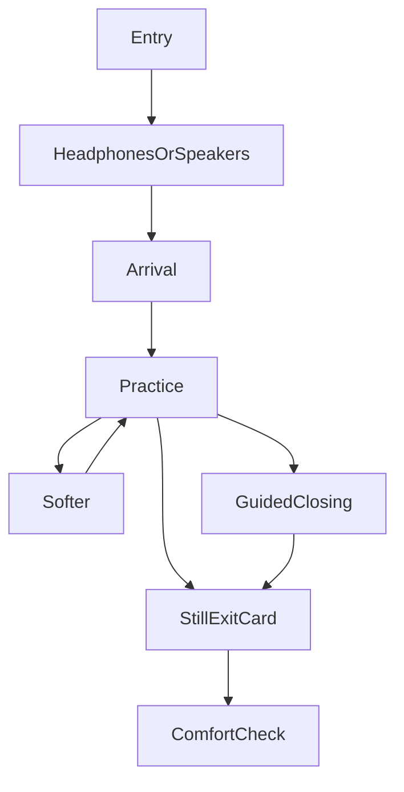

# Game Design Document
## Solution Talk — Seated Practice Space
**For:** Solution Therapy & Coaching
**Version:** 1.1
**Date:** October 2026
**Status:** Living spec. Supersedes the 1.0 concept draft.

This version folds in clinical review, Meta VR Glasses input (SDK v207), and a production bar for sound and session craft. Public positioning follows the practice site: a wellness practice people can stop, alongside psychotherapy, and not a replacement for it.

---

## 1. Vision

**Pitch**
A seated practice space clients of Solution Talk can open between sessions or inside one. The clinician chooses the room, the sound mix, the guidance, and how much stimulation is present. The client can make it softer, freeze it, or return to the physical room at any moment.

**Feeling**
“I am in a steady place that was set for me. I can notice what I notice. I can leave when I want. Nothing here is trying to make me calm.”

**Pillars**
1. **Safety.** Exit is immediate. Language is invitational. The real room stays reachable.
2. **Tunability.** Intensity, sound buses, guidance, and environment are preset, and safety locks hold.
3. **Embodied practice.** Spatial sound and a still image support orienting and dual awareness. The image does not perform.
4. **Clinical continuity.** The same pacing as the courses and the guided meditations already on the site.
5. **Access.** Seated first. The headset build uses Unity and the current Meta XR SDKs, so Quest and later Meta VR Glasses can share one session. A flat-screen version carries the same audio and captions when a headset is unavailable. Future headwear is added only when it can run that session.

**What “AAA” means here**
Craft, not spectacle. Seamless sound, a voice that sits in the room rather than inside the head, captions, a stable horizon, and controls that work by looking or with a controller. Consumer VR meditation apps often spend their polish on worlds, rewards, and an AI companion. This practice spends it on the mix, the script, and the exit.

---

## 2. Who it is for

**Primary.** Adult clients of the practice, across Ontario, in virtual care. Course participants who want a practice between lessons.

**Secondary.** AL, April, and future clinicians, who build and lock presets. The public, only through two fixed demos tied to the free mini-courses.

**Use**

| Use | Who sets it | Length |
|-----|-------------|--------|
| In-session stabilization | Therapist, live or preset | 5–12 min |
| Between-session practice | Locked preset | 8–15 min |
| Free mini-course demo | Fixed public preset | 6–8 min |
| Course module | Course-linked preset | 8–12 min |

Public demos stay inside the free courses: very low intensity, ambience and a short orienting script, no bilateral tones, no binaural beats, no resource-installation work. The in-session name is a practice space. Psychotherapy stays with the clinician.

---

## 3. Session loop

1. **Entry.** Link or saved preset. One line: this is a recording, the therapist is not in the room, and looking only highlights buttons. Headphones or speakers — that choice gates the stereo-only buses.
2. **Arrival.** The preset is already on. Low stimulation. A soft prompt to notice the chair, the room, or the breath, with an outside anchor in the same sentence.
3. **Practice.** Rest, follow a script, or run an optional bilateral set if the preset allows it. Softer, Freeze, and Exit stay in view.
4. **Timed end.** A guided return of attention to the physical room. Offered, and used when the clock ends.
5. **Exit at any time.** One select cuts the scene to a still, silent card: they can take the headset or glasses off. The guided closing can be heard from that card. It never blocks the exit.
6. **After.** Two questions: dizzy or unsteady, and more distressed, the same, or a bit more settled. Plus a visible way to reach the practice. Stored only if a later, consented clinical build exists. The first build keeps the answers on the device.

Around 15 minutes, an Open session asks whether to stay or close. There is no requirement to finish. If attention on the body or the breath makes things louder, the script returns attention to the room. That rule is already on the practice’s guided-meditation page. It is script law here.

---

## 4. Controls

Exit, Softer, and Freeze are large targets in the middle of the field of view, with space between them. One select. No dwell, no second confirm on Exit, no grab, no teleport.

| Control | What it does |
|---------|----------------|
| Exit | Scene stops now. Still card. Guided closing is optional from there. |
| Softer | Intensity down one step. Bilateral and beat buses mute. Guidance ducks. Scene simplifies. Session continues. |
| Freeze | Image and buses hold. Select again to resume. |
| Volume | Voice, ambience, and music, inside the range the clinician left unlocked. |

The same targets accept a gaze ray, a head ray, a hand ray, or a controller trigger. Gaze is optional. Hand tracking is optional. Meta VR Glasses (spring 2027, coming soon) use look, then pinch or tap. Quest uses the same targets with Touch controllers. Voice is not a session control. “Talk to Meta AI” stays a system feature.

Gaze does not change the room, the mix, or a sweep. The session does not record where someone looks. Prefer system-mediated selection, where the page receives the select and not the gaze ray.

---

## 5. Sound — three different things

People say “binaural” for all three. They are separate buses. A clinician can lock each one.

### 5.1 Spatial ambience and voice
The place, heard in headphones as a space. The voice sits a short distance in front, at conversation level, never inside the skull. Water, air, or a soft harmonic bed each have a position. Music, if any, is a bed under the voice, and the voice ducks it. Loops are seamless. A limiter keeps peaks out. Silence is a complete preset.

On speakers, this bus folds down to a simple stereo image. It still plays.

This is the layer public demos and the first prototype use. It is the AAA meditation bar: authored beds, clean edits, pauses that were written, captions on every spoken line.

### 5.2 Bilateral tones
A soft tone that alternates left and right, in sets. This is the dual-awareness tool, kin to what clinicians already do with taps or tones in somatic EMDR preparation. It is off unless a clinician turns it on for a named preset.

A set has a count, a speed from very slow to slow, a pitch, a gap, and a pause before another set can start. The client can stop the set with Softer or Freeze. The tone is a distant tick, not a startle. Combined visual-plus-tone-plus-haptic waits until a pilot. The first versions that include bilateral use tone only, or a slow distant light, not both at full strength.

Headphones are required. On the speakers path this bus stays muted, with a line that says so. Absent from public demos and from the first prototype.

### 5.3 Binaural beats
Two close, steady frequencies, one in each ear, so a slow pulse is heard that is not in either ear alone. Some wellness apps treat a named band (often sold as “alpha” or “theta”) as a relaxation product. Evidence for a specific emotional result is thin, and a pulse can irritate, dizzy, or aggravate migraine. A seizure history is a reason to leave this bus off.

Default off. Clinician preset only. Never in a public demo. Low amplitude, slow, one or two authored beds, not a frequency catalog and not a healing claim. The entry line for a preset that includes it: headphones, and stop if the pulse feels wrong. Softer mutes it immediately. Speakers mute it, because the effect depends on each ear getting its own frequency.

### Mix

| Bus | Public demo | Between-session default | Headphones |
|-----|-------------|-------------------------|------------|
| Spatial ambience | On, very low | On, preset level | Better; works on speakers |
| Voice | Short orienting script | Preset | Either |
| Music | Off or barely present | Off unless preset | Either |
| Bilateral tones | Off, not available | Off | Required |
| Binaural beats | Off, not available | Off | Required |

Intensity scales ambience density, music level, and whether a beat or bilateral bus is even eligible. Very Low is ambience and voice only.

---

## 6. Session modules

Scripts are beats: line, pause, caption, and any bus change. AL or April review every public line before release. A recorded voice of AL or April carries an on-screen line that it is a recording.

| Module | What the person is invited to do | Where it lives |
|--------|----------------------------------|----------------|
| Orienting | Notice the chair, a sound in the real room, one still spot ahead | Every session, including demos |
| Quiet sit | Ambience, optional voice, no task | Demos and presets |
| Breath pacing | A slow visual pulse they may follow, or ignore | Optional, hidden by default. No score, no failure if the breath does not match |
| Body awareness | Feet, or the chair, or a spot ahead — external choice in the same line | Clinician presets |
| Resource | A place, a figure, or a felt sense of support, already known from therapy | Clinician presets only |
| Bilateral set | A counted run of alternating tones, then stillness | Clinician presets only, after the tone tool exists |
| Parts noticing | One line: something in you may show up, and it can be left alone | Clinician presets, IFS-consistent, not a parts map |
| Closing | Attention back to the physical room | Timed end, and offered after Exit |

A still, soft point of focus may sit in the scene. It does not pulse, spiral, or brighten because someone looks at it.

---

## 7. Environments

Authored scenes only. A preset selects among them. It does not generate a new image.

1. **Soft abstract.** Muted fields, almost no objects. First scene to build. Highest-sensitivity days.
2. **Open nature.** Meadow edge, soft shore, or trees, with a clear stable horizon and very little detail.
3. **Stone alcove.** Warm, quiet enclosure. On glasses with an open periphery, enclosure is dimmer light and a closer sound, because the real room may stay visible at the edges.
4. **Hybrid.** Nature with a simple stone or timber frame.

No weather changes, no animals, no approaching figures, no camera moves, no flicker. Reduced motion removes any leftover drift. Nested alcoves stay off until each one has a permanent way back to the main space.

Seated is the only mode in the first releases. The glasses use a tethered puck. Standing and turning are out.

---

## 8. Settings

Presets are versioned documents. The client menu, if the clinician unlocks it, can change volume and a small intensity step, and can always Exit. It cannot unlock a bus the clinician locked off.

| Setting | Options | Default |
|---------|---------|---------|
| Intensity | Very low, Low, Moderate | Low |
| Environment | Abstract, Nature, Stone, Hybrid | Abstract for new presets |
| Visual complexity | Minimal, Soft | Soft |
| Buses | Ambience, music, voice, bilateral, beats — each level or off | Ambience on, others off |
| Bilateral speed and set length | Very slow to slow; count and pause | Off |
| Guidance | Silent, narrator, AL, April | Narrator |
| Length | 5, 8, 12, 15, Open with a 15-minute check | 8 |
| Exit | Instant to the still card | Instant |
| Closing | Short, medium | Medium, never a gate |
| Motion | Reduced motion on or off | On for new presets |
| Playback | Headphones or speakers | Asked at entry |

---

## 9. What other apps do, and what this practice takes

A 2026 review of commercial VR mindfulness apps (Headspace XR, Hoame, Innerworld, Maloka, TRIPP) rated information quality as their weakest area, and found exits that were hard to find. Clinical and consumer products nearby add tools this draft did not name. Each one below is either adopted, adapted, or left out on purpose.

**Adopt**
- Separate ambience, music, and voice levels, the way TRIPP and Headspace treat sound as the product.
- A short clinical window, in the range Healium uses for in-office sessions (about 4–20 minutes).
- A headphones check, because bilateral tones and binaural beats are stereo-only. TRIPP already says binaural audio is for headphones.
- Set controls from remote EMDR tools: count, speed, pause, and a way for the client to stop a set.
- A plain comfort check after the session, and contact for the practice on the exit card.
- Offline playback of an assigned preset, so home practice does not depend on a connection.
- High-resolution, adult art direction. The same review noted cartoon worlds reading as younger than the audience.

**Adapt**
- Breath pacing, without a score and without a claim that matching the pulse will calm anyone. Default hidden.
- A single before/after question, without a mood streak or a points balance.
- Biofeedback later, if ever: a heart-rate view the person can show or hide. The scene stays as the preset left it. Healium’s scene reacts to EEG and heart rate. A world that shifts because a sensor decides someone is stressed is the wrong surprise for this practice.

**Leave out**
- AI coaches, generated images, and generated scripts. TRIPP’s Kōkua is a different product. Every public line here is reviewed.
- Other people in the room. Shared meditation spaces in TRIPP, Hoame, and Innerworld break privacy and predictability.
- Streaks, rewards, islands, and spirit guides. Maloka’s rewards add pressure the courses explicitly avoid.
- Sleep induction in the headset. Falling asleep in a device is a safety problem, and this is not a sleep app.
- Trauma-exposure scenes, combat, crowds, or autobiographical imagery.
- Screenshots, recording of the view, microphone capture, room meshes, and gaze logs.
- Avatars of the therapists.

---

## 10. Safety and privacy

Always in view: Exit, Softer, Freeze. No autoplay of high intensity. No sudden sound, camera, or light. Seated. Captions. Language does not promise a feeling.

The first build stores nothing on a server: the preset is local, there is no account, and the comfort check is not uploaded. A later client list, notes, or saved check-ins are personal health information and a separate product, with expiring links that contain no clinical words.

Do not collect gaze, microphone, room geometry, or headset view. Meta’s eye-tracking path can hand an immersive app a live gaze ray. This practice does not keep it.

---

## 11. Build order

| Phase | What exists at the end |
|-------|------------------------|
| 0 | Soft-abstract scene. Spatial ambience and optional voice. Captions. Headphones question. Softer, Freeze, instant Exit. One reviewed script. No bilateral, no beats, no accounts. |
| 1 | Two public demos matched to “You’re Not Broken” and “Why Calm Doesn’t Work.” Ambience, music, and voice buses. |
| 2 | Clinician presets for the remaining scenes. Bilateral sets. Optional beat bed, locked off. |
| 3 | Course modules from Somatic Foundations and Anxiety & Nervous System Regulation. |
| 4 | Live clinician adjustment of buses and intensity during a co-present session, with changes faded, never snapped. |

Phase 0 is exercised in the Meta VR Glasses field-of-view mask and on Quest with gaze off, so Exit still works on a head ray and on a controller.

---

## 12. How we will know it is working

- Clients can say what Exit does before the first minute is over.
- Softer is used, and early exits are read as titration unless they cluster at the start.
- Comfort-check answers, especially dizziness and “more distressed.”
- Clinicians actually assign presets, once that tool exists.
- Public demos stay inside the mini-course boundary.

Qualitative notes from AL and April outrank completion rate. Finishing is not the goal.

---

## 13. Still open

1. Narrator, AL, April, or a mix for the first recorded scripts.
2. Whether public demos require an email or stay fully open. Either way they stay clinically capped.
3. Whether the beat bus belongs in version 2 or waits for a pilot. The spec allows it only as a locked, default-off preset.
4. Brand line on the public page: practice space of Solution Talk, with the wellness boundary written the way the meditation page already writes it.

---

## Appendix — Course fit

- **You’re Not Broken** and **Why Calm Doesn’t Work.** The two public demos. Orienting and a quiet sit. The second demo in particular does not coach someone to become calm.
- **Somatic Foundations** and **Anxiety & Nervous System Regulation.** Later modules: body awareness, optional breath, resource, still with an external anchor.
- **Somatic EMDR preparation.** Bilateral sets, only inside a clinician preset, after the rest of the safety layer is already shipping.
- **Guided meditations already on the site.** Same stop rule, same “not a substitute for psychotherapy” line, now with a room around the voice.
